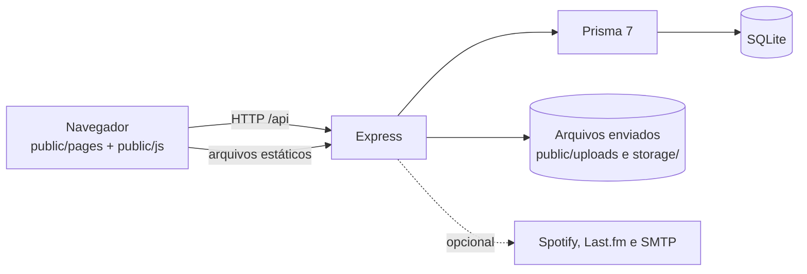

# Backstage Cena

Plataforma web para músicos independentes se conhecerem, entrarem em clubes por gênero, instrumento ou DAW e organizarem projetos musicais juntos.

<!--
Capa do repositório: quando houver uma captura principal, salve em docs/img/feed.png e descomente a linha abaixo.


Capturas que ainda faltam (salvar em docs/img/):
- docs/img/feed.png: feed com os filtros e as prévias
- docs/img/perfil.png: perfil com atividade musical
- docs/img/clube-chat.png: clube com chat
- docs/img/workon.png: página de um Work On
- docs/img/configuracoes.png: configurações com listas agrupadas
-->

## Índice

1. [Funcionalidades](#funcionalidades)
2. [Stack e arquitetura](#stack-e-arquitetura)
3. [Como rodar](#como-rodar)
4. [Variáveis de ambiente](#variáveis-de-ambiente)
5. [Usuários de exemplo](#usuários-de-exemplo)
6. [Scripts e testes](#scripts-e-testes)
7. [Visão geral da API](#visão-geral-da-api)
8. [Segurança e privacidade](#segurança-e-privacidade)
9. [Integração de música](#integração-de-música)
10. [Design](#design)
11. [Limitações conhecidas e próximos passos](#limitações-conhecidas-e-próximos-passos)
12. [Contribuição e licença](#contribuição-e-licença)

## Funcionalidades

**Conta e acesso**
- Cadastro em três etapas (conta, perfil e detalhes) e login com token JWT.
- Recuperação de senha por e-mail com código de 6 dígitos válido por 15 minutos.
- Alteração de senha e exclusão da conta nas configurações.

**Perfil**
- Nome, biografia, localização, contato, instrumentos, gêneros, DAWs, área de atuação e redes sociais.
- Foto de perfil com recorte no navegador.
- Status de disponibilidade (disponível, ocupado, não perturbe, invisível).
- Configurações de privacidade do perfil.
- Pesquisa de músicos com filtros.

**Feed e postagens**
- Prévias de áudio com seleção do trecho (até 60 segundos, arquivo de até 15 MB), visíveis por 24 horas no feed.
- Tweets de até 280 caracteres, com imagem opcional e expiração opcional em 24 horas.
- Feed com os filtros "Tudo" e "Work Ons".

**Clubes**
- Clubes por gênero, instrumento, DAW ou gerais, com busca, filtro por tipo e imagem.
- Clubes recomendados no feed.
- Chat em cada clube: só membros leem e escrevem, mensagens de até 500 caracteres.
- Os clubes de cada pessoa aparecem no perfil.

**Work On**
- Projetos (álbum, EP, single, beat tape ou outro) com status de ideia a lançado.
- Visibilidade pública ou por link de convite; papéis de dono, editor e ouvinte.
- Faixas com versões de áudio, tarefas, fotos, capa e membros.
- Publicar uma versão como prévia e compartilhar o projeto em um clube.

**Música**
- Conexão com Last.fm e Spotify para mostrar o que a pessoa está ouvindo e os mais ouvidos.
- Escolha de quem vê a atividade: todos, só pessoas dos clubes ou ninguém.

**Em desenvolvimento**
- Spotify: limitado a poucos testadores enquanto o app estiver em modo de desenvolvimento (veja [Integração de música](#integração-de-música)).
- Filtros do feed por tipo (tweets, postagens, prévias, clubes): hoje só existem "Tudo" e "Work Ons".

## Stack e arquitetura

| Camada | Tecnologia (versão do `package.json`) |
| --- | --- |
| Servidor | Node.js, Express 4, TypeScript 5, tsx |
| Banco | SQLite com Prisma 7 (adaptador libSQL) |
| Autenticação | JWT (`jsonwebtoken` 9) e Argon2 (`argon2` 0.45) |
| Validação | Zod 4 |
| Upload | Multer 2 |
| E-mail | Nodemailer 10 |
| Limite de requisições | `express-rate-limit` 8 |
| Front-end | HTML, CSS e JavaScript ESM, sem framework e sem etapa de build |
| Testes | Vitest 5, Supertest 7, JSDOM 29, Playwright 1.63 |



```text
src/
  server.ts        ponto de entrada (porta 3000 por padrão)
  app.ts           middlewares e montagem das rotas
  routes/          uma rota por módulo (usuário, imagem, postagem, tweet, clube, Work On, música)
  controllers/     tradução de requisição e resposta
  models/          acesso ao banco
  services/        regras de negócio e integrações de música
  schema/          validações Zod
  middlewares/     autenticação, JSON obrigatório e tratamento de erros
  config/          Multer e e-mail
prisma/            schema.prisma, migrações e seed
public/
  pages/           páginas HTML
  css/             tokens.css, components.css e CSS de cada área
  js/              módulos do front-end
  uploads/         arquivos públicos (avatares, tweets, capas e fotos)
storage/           áudios privados dos Work Ons (criado ao subir o servidor)
tests/             unit, api, front e e2e
```

## Como rodar

**Pré-requisitos:** Node.js 20.19 ou superior (ou 22.12+, ou 24+), exigência do Prisma 7, e npm.

```bash
npm install
cp .env.example .env
# edite o .env: JWT_SECRET e WORKON_FILE_SECRET são obrigatórios (veja a tabela abaixo)
npx prisma generate
npx prisma migrate deploy
npm run seed
npm run dev
```

O `npm run setup` executa `prisma generate`, `prisma migrate deploy` e o seed de uma vez.

O servidor sobe em `http://localhost:3000`. A raiz (`/`) responde com um JSON de status; a aplicação abre em
`http://localhost:3000/pages/index.html`.

### Codespaces

1. Abra o repositório em um Codespace e rode os comandos acima no terminal.
2. Na aba **Portas**, encontre a porta 3000 e mude a visibilidade para **Pública**.
3. Copie a URL da porta (formato `https://<nome>-3000.app.github.dev`) e use-a em `CORS_ORIGIN` e `APP_PROFILE_URL`, no lugar de `http://localhost:3000`.
4. Reinicie o `npm run dev` e abra `<URL da porta>/pages/index.html`.

## Variáveis de ambiente

Copie `.env.example` para `.env`. O `.env` está no `.gitignore`; nunca versione valores reais.

| Nome | Obrigatória | Para que serve | Como gerar ou exemplo |
| --- | --- | --- | --- |
| `DATABASE_URL` | Sim | Caminho do banco SQLite | `file:./dev.db` |
| `JWT_SECRET` | Sim | Assina os tokens de login (validade de 1 hora) | `node -e "console.log(require('crypto').randomBytes(32).toString('hex'))"` |
| `WORKON_FILE_SECRET` | Sim, para Work On | Assina as URLs temporárias dos áudios privados | mesmo comando do `JWT_SECRET` |
| `RESET_CODE_SECRET` | Não | Protege o código de redefinição de senha; se faltar, usa o `JWT_SECRET` | mesmo comando do `JWT_SECRET` |
| `NODE_ENV` | Não | Em `development` sem `EMAIL_HOST`, os e-mails usam uma conta de teste do Ethereal | `development` |
| `CORS_ORIGIN` | Não | Origens permitidas, separadas por vírgula | `http://localhost:3000` |
| `APP_PROFILE_URL` | Não | Link do perfil usado nos e-mails | `http://localhost:3000/pages/perfil.html` |
| `EMAIL_HOST`, `EMAIL_PORT`, `EMAIL_SECURE`, `EMAIL_USER`, `EMAIL_PASS` | Não | Servidor SMTP real | `smtp.exemplo.com`, `587`, `false`, `usuario`, `senha-do-provedor` |
| `EMAIL_FROM`, `EMAIL_REPLY_TO` | Não | Remetente e resposta dos e-mails | `Backstage <nao-responder@exemplo.com>` |
| `SPOTIFY_CLIENT_ID` | Só para Spotify | Identificador do app criado no painel do Spotify | copiado do painel de desenvolvedores |
| `SPOTIFY_REDIRECT_URI` | Só para Spotify | Endereço de retorno do OAuth; precisa ser HTTPS ou IP de loopback | `https://exemplo.dev/api/musica/spotify/callback` |
| `MUSICA_TOKEN_KEY` | Só para música | Chave que criptografa os tokens de música (32 bytes em base64) | `node -e "console.log(require('crypto').randomBytes(32).toString('base64'))"` |
| `LASTFM_API_KEY` | Só para Last.fm | Chave da API do Last.fm | copiada do painel do Last.fm |
| `PORT` | Não | Porta do servidor (padrão 3000); se definir, preencha com um número | `3000` |
| `WORKON_AUDIO_MAX_MB` | Não | Limite de áudio por versão de Work On (padrão 50); se definir, preencha com um número | `50` |

Todos os valores acima são exemplos fictícios.

## Usuários de exemplo

O `npm run seed` cria dez usuários, todos com a senha `123456`:

`lucas@email.com`, `fernanda@email.com`, `rafael@email.com`, `anab@email.com`, `diego@email.com`,
`mariana@email.com`, `bruno@email.com`, `juliana@email.com`, `thiago@email.com` e `camila@email.com`.

> Essas contas existem só para o ambiente local de desenvolvimento. Não rode o seed em produção.

## Scripts e testes

| Comando | O que faz |
| --- | --- |
| `npm run dev` | Servidor com recarga automática (`tsx watch`) |
| `npm start` | Servidor sem recarga |
| `npm run build` | Compila o TypeScript com `tsc` |
| `npm run setup` | `prisma generate`, `migrate deploy` e seed |
| `npm run reset` | Recria o banco (`migrate reset`) e roda o seed; apaga os dados |
| `npm run seed` (`db:load`) | Popula o banco com os usuários de exemplo |
| `npm run db:reload` | Atalho para `npm run reset` |
| `npm run prisma:generate`, `prisma:push`, `prisma:studio` | Atalhos do Prisma |
| `npm test` | Testes unitários e de API (Vitest e Supertest) |
| `npm run front:test` | Testes do front-end em JSDOM |
| `npm run e2e` | Teste de ponta a ponta com Playwright (sobe o servidor na porta 4173) |
| `npm run coverage` | Cobertura de testes |

O que cada grupo cobre:

- **`tests/unit`:** modelo de usuário, esquemas Zod e a base da integração de música.
- **`tests/api`:** rotas de usuário e redefinição de senha, limite de requisições, imagem de perfil, postagens e tweets, clubes, Work On e música (incluindo OAuth).
- **`tests/front`:** autenticação, navbar, busca em overlay, recorte de imagem, Work On, música, perfil e postagens.
- **`tests/e2e`:** fluxo de login.

## Visão geral da API

Todas as rotas ficam sob `/api`. Quando a coluna **Auth** diz "Sim", é preciso enviar `Authorization: Bearer <token>`.
Exemplos prontos para o VS Code (extensão REST Client) estão em [`request.http`](request.http). O projeto não tem OpenAPI.

### Usuários (`/api/usuarios`)

| Método | Rota | Auth | Descrição |
| --- | --- | --- | --- |
| POST | `/` | Não | Cadastra um usuário |
| POST | `/login` | Não | Login (limite de 10 tentativas por 15 minutos) |
| POST | `/esqueci-senha` | Não | Envia o código de redefinição (limite de 5 por 15 minutos) |
| POST | `/redefinir-senha` | Não | Redefine a senha com o código (limite de 5 por 15 minutos) |
| GET | `/` | Não | Lista e pesquisa músicos |
| GET | `/:id` | Não | Perfil de um usuário |
| PUT | `/:id` | Sim | Atualiza o perfil |
| DELETE | `/:id` | Sim | Exclui a conta |
| PATCH | `/:id/status` | Sim | Atualiza o status de disponibilidade |
| GET, PUT | `/:id/configuracoes` | Sim | Lê e altera as configurações de privacidade |
| PUT | `/:id/senha` | Sim | Altera a senha |
| GET | `/estados`, `/areas`, `/instrumentos`, `/generos`, `/daws`, `/disponibilidades` | Não | Listas usadas nos formulários |

### Imagem de perfil (`/api/usuarios/imagem`)

| Método | Rota | Auth | Descrição |
| --- | --- | --- | --- |
| POST, PUT | `/` | Sim | Envia a foto de perfil (`multipart/form-data`, JPEG, PNG ou GIF de até 2 MB) |

### Postagens (`/api/postagens`) e tweets (`/api/tweets`)

| Método | Rota | Auth | Descrição |
| --- | --- | --- | --- |
| GET | `/api/postagens/feed` | Não | Prévias de áudio recentes |
| GET | `/api/postagens/usuario/:id_usuario` | Não | Postagens de uma pessoa |
| POST | `/api/postagens` | Sim | Publica uma prévia (áudio de até 15 MB) |
| DELETE | `/api/postagens/:id` | Sim | Remove uma postagem |
| GET | `/api/tweets/feed` | Não | Tweets recentes |
| GET | `/api/tweets/usuario/:id_usuario` | Não | Tweets de uma pessoa |
| POST | `/api/tweets` | Sim | Publica um tweet, com imagem opcional |
| DELETE | `/api/tweets/:id` | Sim | Remove um tweet |

### Clubes (`/api/clubes`)

| Método | Rota | Auth | Descrição |
| --- | --- | --- | --- |
| GET | `/` | Sim | Lista clubes, com busca e filtro por tipo |
| GET | `/recomendados` | Sim | Clubes recomendados para a pessoa |
| GET | `/meus` | Sim | Clubes de que a pessoa participa |
| GET | `/usuario/:id_usuario` | Não | Clubes de um usuário |
| POST | `/` | Sim | Cria um clube |
| GET | `/:id` | Sim | Detalhes e membros |
| DELETE | `/:id` | Sim | Remove o clube |
| GET | `/:id/busca` | Sim | Busca dentro do clube (parâmetro `q`) |
| POST, PUT | `/:id/imagem` | Sim | Envia a imagem do clube |
| POST | `/:id/entrar` | Sim | Entra no clube |
| DELETE | `/:id/sair` | Sim | Sai do clube |
| GET | `/:id/mensagens` | Sim | Lê o chat (só membros) |
| POST | `/:id/mensagens` | Sim | Envia mensagem (só membros, até 500 caracteres) |

### Work On (`/api/workons`)

| Método | Rota | Auth | Descrição |
| --- | --- | --- | --- |
| GET | `/` | Sim | Lista projetos |
| GET | `/meus` | Sim | Projetos da pessoa |
| GET | `/usuario/:id_usuario` | Não | Projetos de um usuário |
| POST | `/` | Sim | Cria um projeto |
| POST | `/entrar-por-convite` | Sim | Entra com um token de convite |
| GET, PATCH, DELETE | `/:id` | Sim | Detalhes, edição e remoção |
| GET | `/:id/resumo` | Sim | Resumo do projeto |
| POST, DELETE | `/:id/entrar`, `/:id/sair` | Sim | Entrar e sair |
| POST, DELETE | `/:id/convite` | Sim | Gera e revoga o link de convite |
| GET, POST | `/:id/membros` | Sim | Lista e adiciona membros |
| PATCH, DELETE | `/:id/membros/:id_usuario` | Sim | Altera o papel ou remove um membro |
| POST | `/:id/faixas` | Sim | Cria uma faixa |
| PATCH, DELETE | `/:id/faixas/:idFaixa` | Sim | Edita e remove uma faixa |
| PATCH | `/:id/faixas/reordenar` | Sim | Reordena as faixas |
| POST | `/:id/faixas/:idFaixa/versoes` | Sim | Envia uma versão de áudio |
| DELETE | `/:id/faixas/:idFaixa/versoes/:idVersao` | Sim | Remove uma versão |
| GET | `/:id/versoes/:idVersao/url` | Sim | Gera a URL assinada do áudio |
| GET | `/arquivos/:token` | Assinada | Entrega o áudio enquanto a assinatura é válida |
| POST | `/:id/versoes/:idVersao/publicar-previa` | Sim | Publica a versão como prévia |
| POST | `/:id/compartilhar-em-clube` | Sim | Compartilha o projeto em um clube |
| POST | `/:id/tarefas` | Sim | Cria uma tarefa |
| PATCH, DELETE | `/:id/tarefas/:idTarefa` | Sim | Edita e remove uma tarefa |
| PATCH | `/:id/tarefas/reordenar` | Sim | Reordena as tarefas |
| POST | `/:id/fotos` | Sim | Envia uma foto |
| PATCH, DELETE | `/:id/fotos/:idFoto` | Sim | Edita a legenda e remove uma foto |
| PATCH | `/:id/fotos/reordenar` | Sim | Reordena as fotos |
| PUT, DELETE | `/:id/capa` | Sim | Troca e remove a capa |

### Música (`/api/musica`)

| Método | Rota | Auth | Descrição |
| --- | --- | --- | --- |
| POST | `/spotify/conectar` | Sim | Inicia a conexão com o Spotify |
| GET | `/spotify/callback` | Não | Retorno do OAuth do Spotify |
| POST | `/lastfm/conectar` | Sim | Conecta um usuário do Last.fm |
| GET, PATCH, DELETE | `/minha` | Sim | Lê a conexão, altera a visibilidade e desconecta |
| GET | `/usuario/:id/agora` | Opcional | O que a pessoa está ouvindo agora |
| GET | `/usuario/:id/top` | Opcional | Mais ouvidos da pessoa |

As rotas de música usam limite de 10 requisições por 15 minutos (conexão) e de 120 por 15 minutos (leitura).

## Segurança e privacidade

- **Autenticação:** senhas com Argon2, tokens JWT de 1 hora e rotas protegidas por middleware.
- **Validação:** todas as entradas passam por esquemas Zod, e o prefixo `/api/usuarios` exige `Content-Type: application/json` (exceto o envio de imagem).
- **Uploads:** só JPEG, PNG e GIF nas imagens, com limites de tamanho e um arquivo por envio; áudio de prévia com limite de 15 MB e áudio de Work On com limite configurável (50 MB por padrão).
- **Áudio de Work On privado:** os arquivos ficam em `storage/`, fora da pasta pública, e só saem por URL assinada com HMAC-SHA256 e prazo de validade (`WORKON_FILE_SECRET`).
- **Tokens de música:** criptografados com AES-256-GCM (`MUSICA_TOKEN_KEY`); o estado do OAuth do Spotify é assinado.
- **Visibilidade da atividade musical:** cada pessoa escolhe entre `publico`, `clubes` e `oculto`.
- **Limite de requisições:** login, redefinição de senha e rotas de música têm limites por janela de 15 minutos.
- **Respostas de usuário:** a senha e os dados do código de redefinição são removidos das respostas.

## Integração de música

Há dois provedores: Last.fm e Spotify.

**Last.fm (alternativa mais simples).** Basta uma chave de API em `LASTFM_API_KEY`; a pessoa informa o nome de usuário
e o app mostra no perfil o que o Last.fm registrou ("scrobbles"). Se a pessoa ocultar a atividade recente no
Last.fm, o app não consegue exibi-la.

**Spotify.**
1. Crie um app no [painel de desenvolvedores do Spotify](https://developer.spotify.com/dashboard) usando uma conta **Premium**.
2. Cadastre em **Redirect URIs** o mesmo valor de `SPOTIFY_REDIRECT_URI`. Ele precisa ser HTTPS ou um IP de loopback literal.
3. Copie o Client ID para `SPOTIFY_CLIENT_ID` e gere a `MUSICA_TOKEN_KEY`.
4. Adicione cada testador em **User Management** do app.

Segundo a documentação do Spotify (regras de fevereiro de 2026), apps em modo de desenvolvimento exigem que o dono tenha
Premium ativo, aceitam até 5 usuários autorizados e usam um conjunto reduzido de endpoints. Para mais gente é preciso
pedir cota estendida, e quem não estiver na lista de testadores não consegue conectar. Veja o
[guia de migração do Spotify](https://developer.spotify.com/documentation/web-api/tutorials/february-2026-migration-guide).
O app só lê o que está tocando e os mais ouvidos (`user-read-currently-playing` e `user-top-read`).

Spotify e Last.fm são marcas de seus respectivos donos. Este projeto não é afiliado nem endossado por nenhuma das duas
plataformas; os dados de música exibidos vêm das APIs delas.

## Design

O visual segue um sistema próprio, escuro primeiro, definido em `public/css/`:

- **Tokens** em [`tokens.css`](public/css/tokens.css): cores, tipografia, espaços, raios, sombras e movimento. Nenhum outro arquivo define cor ou raio fixo.
- **Acento violeta** como única cor de destaque; verde só para sucesso e vermelho só para perigo.
- **Tipografia** única: Inter em todo o app, com escala fluida.
- **Liquid Glass com disciplina:** o vidro (fundo translúcido, desfoque e borda clara) aparece só na barra superior, na tab bar, no menu do avatar, nas janelas (sheets) e na barra de filtros. Cards, listas, chat e formulários são opacos.
- **Acessibilidade:** contraste mínimo de 4,5:1 para texto, foco visível, alvos de toque de 44 px, suporte a `prefers-reduced-motion`, `prefers-reduced-transparency` e `prefers-contrast`, e fallback opaco quando o navegador não suporta `backdrop-filter`.
- **Componentes** em [`components.css`](public/css/components.css): botões, campos, controle segmentado, cards, listas agrupadas, sheets, navegação e chat.

A página [`public/pages/_styleguide.html`](public/pages/_styleguide.html) mostra todos os componentes. Com o servidor
rodando, abra `/pages/_styleguide.html`.

## Limitações conhecidas e próximos passos

- O Spotify depende do modo de desenvolvimento e aceita poucos testadores.
- O feed ainda não filtra por tweets, postagens, prévias ou clubes.
- Só existe tema escuro.
- O repositório não tem documentação OpenAPI; a referência de rotas é este README e o `request.http`.
- A cobertura mínima configurada nos testes é baixa (25% de linhas), e há um único teste de ponta a ponta.

Próximos passos, sem data: ampliar os filtros do feed, avaliar o modo claro e aumentar a cobertura de testes.

## Contribuição e licença

Para contribuir, abra uma issue descrevendo o problema ou a ideia e envie um pull request a partir de uma branch
própria. Antes de enviar, rode `npm test` e `npm run front:test`.

O projeto usa a licença MIT; veja o arquivo [`LICENSE`](LICENSE).
